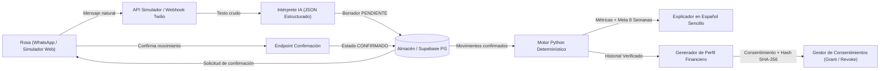

# Arquitectura del Sistema — Qullqi Rimay

## 1. Visión General

**Qullqi Rimay** está diseñado bajo una arquitectura **Clean & Auditable FinTech MVP** que separa estrictamente:
1. **Capa de Interpretación Conversacional (IA / NLP)**: Convierte mensajes libres de WhatsApp (con modismos peruanos/ayacuchanos y vocablos quechuas como *qullqi*, *rantiy*, *qhatu*, *palta*, *jabas*) en una estructura JSON tipada (`StructuredExtractionResult`).
2. **Capa de Confirmación Humana (Human-in-the-Loop)**: Todo registro extraído por IA nace con estado `PENDIENTE`. Solo pasa a `CONFIRMADO` cuando Rosa presiona confirmar o responde *"Sí"* en el flujo de WhatsApp.
3. **Motor Financiero Determinístico en Python (`finance_engine.py`)**: Realiza todos los cálculos matemáticos con precisión decimal (sumatorias semanales, margen operativo, constancia de registro, progreso de la meta de 8 semanas e indicadores del perfil financiero). **Ningún cálculo financiero es delegado al LLM.**
4. **Capa de Explicación en Español Sencillo (`explainer.py`)**: Traduce las métricas calculadas por Python en consejos claros, empáticos y libres de jerga bancaria.
5. **Capa de Perfil Financiero y Consentimiento (`profile_consent.py`)**: Genera un reporte verificable con huella criptográfica SHA-256 de la evidencia y administra el ciclo de vida del consentimiento (`ACTIVO` / `REVOCADO`).



---

## 2. Esquema JSON Estructurado del Intérprete IA

El servicio `interpreter.py` garantiza la salida bajo el esquema `StructuredMovementExtraction`:

```json
{
  "detected_intent": "REGISTRAR_MOVIMIENTO",
  "confidence": 0.96,
  "requires_confirmation": true,
  "items": [
    {
      "movement_type": "VENTA",
      "amount_pen": 180.0,
      "category": "Frutas de estación",
      "description": "Venta de palta fuerte y lúcuma",
      "detected_terms": ["palta fuerte", "lúcuma"]
    },
    {
      "movement_type": "GASTO",
      "amount_pen": 45.0,
      "category": "Logística y empaque",
      "description": "Compra de jabas y transporte",
      "detected_terms": ["jabas", "transporte"]
    }
  ],
  "reply_preview_es": "¡Hola casera Rosa! Entendí 1 venta por S/ 180.00 y 1 gasto por S/ 45.00. ¿Confirmas para guardarlos en tu Semana 8?"
}
```

---

## 3. Reglas de Seguridad y Ética Financiera

- **Prohibición de falsas aprobaciones del BCP**: El perfil financiero incluye el campo obligatorio `regulatory_disclaimer`: *"Este documento es un resumen informativo de historial operativo autodeclarado y confirmado por la titular en Qullqi Rimay. NO constituye una evaluación crediticia, preaprobación ni aprobación de préstamo por parte del BCP ni de ninguna entidad del sistema financiero."*
- **Protección de evidencias y consentimientos**: Cada movimiento confirmado almacena la evidencia del mensaje original (`raw_message`) y la marca de tiempo de confirmación (`confirmed_at`). Cada consentimiento otorgado genera un `evidence_hash` SHA-256 sobre el estado del perfil y el registro de autorización; al revocarlo (`POST /api/consents/{id}/revoke`), el token público deja de devolver datos inmediatamente (HTTP 403 con constancia de revocación).
- **Aislamiento de secretos**: Ninguna clave API se incluye en el código fuente ni en el bundle de React.

---

## 4. Despliegue Previsto (Fase Posterior)

- **Backend**: Render Web Service (`backend/render.yaml`) ejecutando `uvicorn app.main:app --host 0.0.0.0 --port $PORT`.
- **Frontend**: Vercel (`frontend/vercel.json`) sirviendo la SPA compilada con Vite.
- **Base de Datos**: Supabase PostgreSQL (`docs/SUPABASE_SCHEMA.sql`) con políticas RLS e historial de auditoría.

